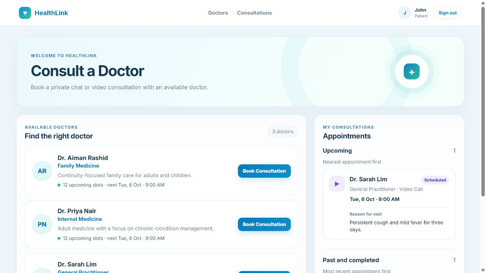
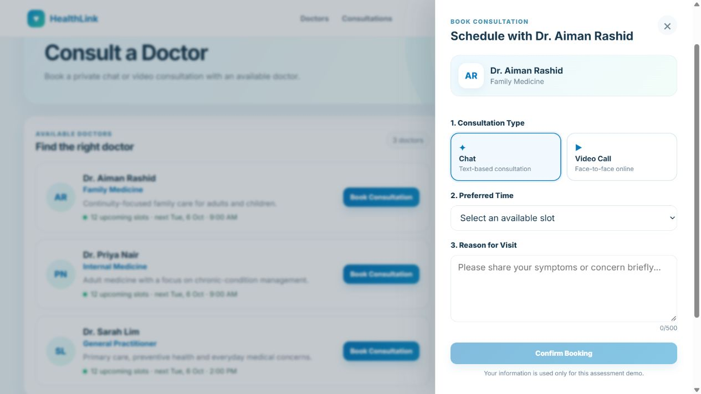
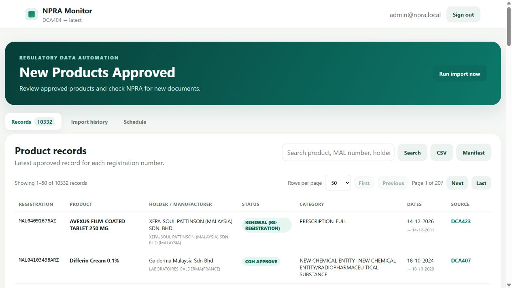
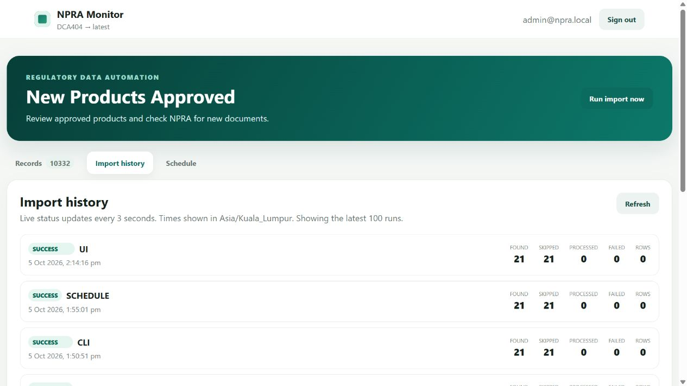
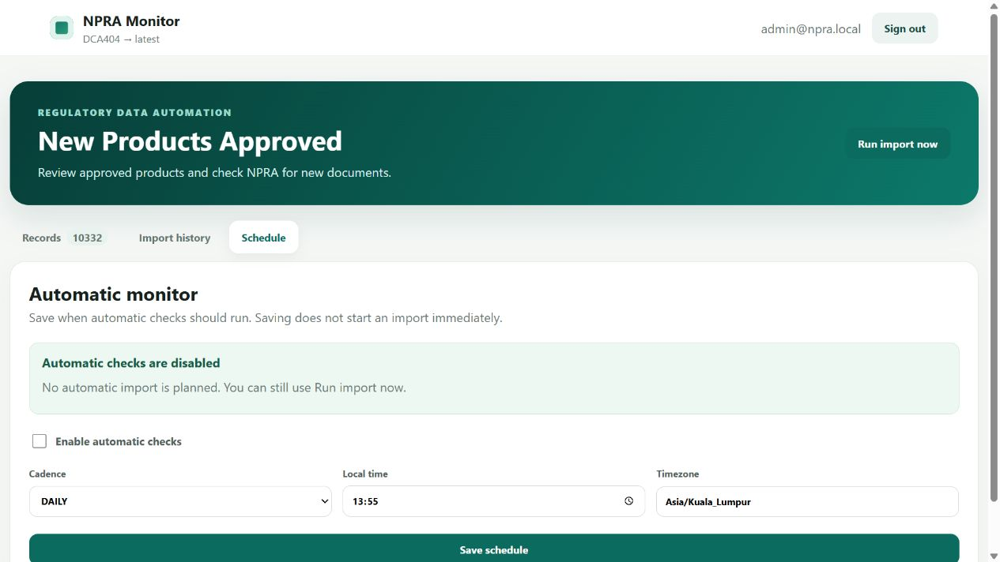
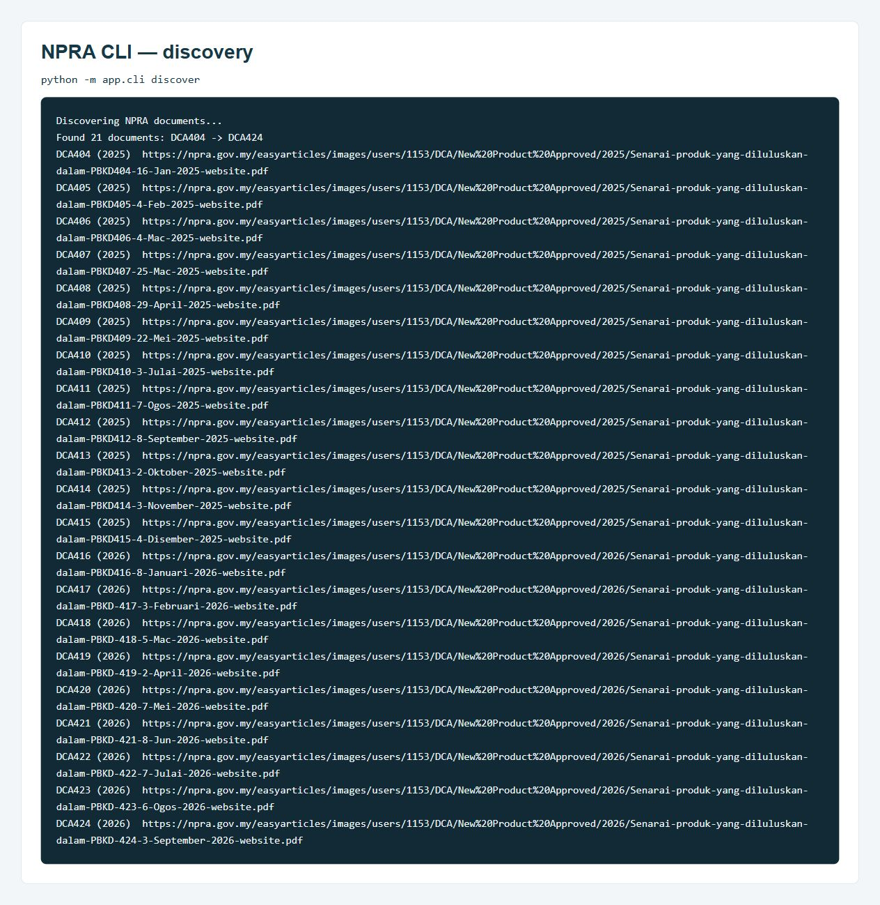
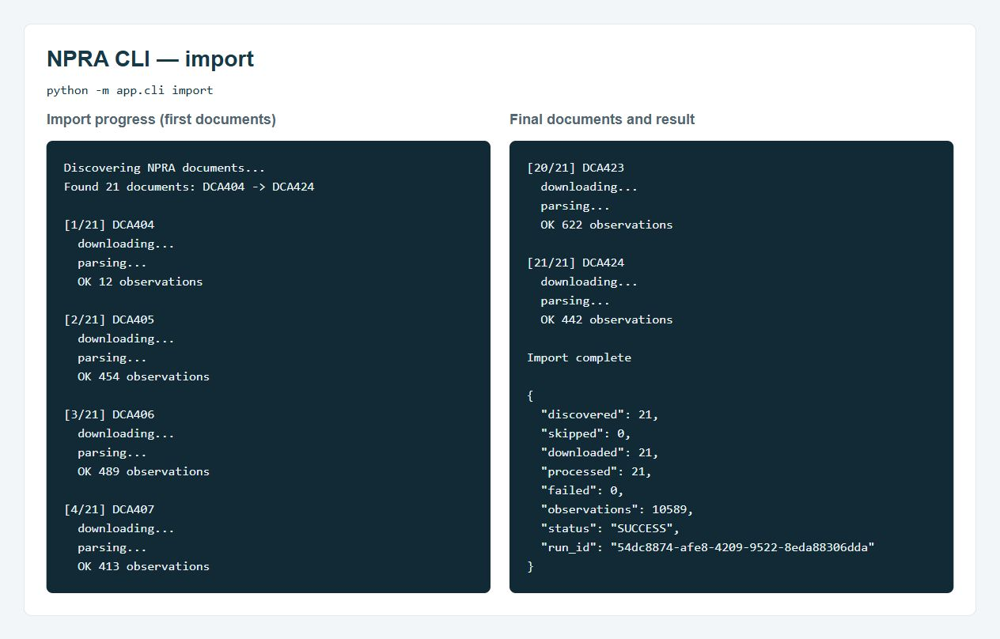

# Digital Health Automation Suite

Two standalone demo applications: **HealthLink**, a consultation booking portal, and **NPRA Monitor**, an automation dashboard for collecting approved-product data from NPRA PDFs.

| Application | What it does | Main technologies |
| --- | --- | --- |
| [HealthLink](healthlink/README.md) | Browse doctors, book consultations, and manage appointments through patient, doctor, and admin accounts. | Angular, NestJS, Prisma, PostgreSQL |
| [NPRA Monitor](npra-monitor/README.md) | Discover and download NPRA documents, extract product records, and track manual or scheduled imports. | Angular, FastAPI, Playwright, pdfplumber, APScheduler, PostgreSQL |

Each application has its own Docker Compose setup and database. They run separately and use separate sign-ins.

## Run locally

Install [Docker Desktop](https://www.docker.com/products/docker-desktop/) with Linux containers enabled, or Docker Engine with Compose v2. Internet access is needed for the first build and for live NPRA imports.

Download this repository using **Code > Download ZIP**, then extract it. You can also clone it if you use Git.

### HealthLink

Open a terminal in the `healthlink` folder and run:

```sh
docker compose up -d --build
```

Wait for startup, then open [http://localhost:4200](http://localhost:4200).

| Role | Email | Password |
| --- | --- | --- |
| Patient | john@healthlink.local | healthlink-demo-2026 |
| Doctor | sarah.lim@healthlink.local | healthlink-demo-2026 |
| Admin | admin@healthlink.local | healthlink-demo-2026 |

Select the matching role when signing in. The login form includes the demo credentials.

**Try it:** sign in as a patient, choose a doctor, select a future slot, and book a consultation. View the saved booking in your consultations. Doctor and admin accounts provide their own management screens.

Chat and Video Call are consultation booking types. This demo does not implement live messaging or video calls. Patient and doctor details are fictional demo data.

See the [HealthLink README](healthlink/README.md) for architecture, tests, and configuration.

### NPRA Monitor

Open a separate terminal in the `npra-monitor` folder and run:

```sh
docker compose up -d --build
```

Wait for the services to start, then open [http://localhost:4201](http://localhost:4201).

Sign in with **admin@npra.local** / **npra-demo-2026**. These credentials are prefilled on the login screen.

**Try it:** click **Run import now**, follow the run in **Import history**, then browse the imported products in **Records**. The first import can take several minutes; a new database starts empty. Open **Schedule** to configure automatic checks while the application is running.

The importer collects NPRA New Products Approved PDFs from DCA404 (January 2025) onward. It stores product details with source references and skips documents that were already imported successfully. PDF extraction uses deterministic parsing; it does not require an AI API key.

See the [NPRA Monitor README](npra-monitor/README.md) for CLI commands, exports, tests, and scheduling details.

### Stop an application

Run this from that application's folder:

```sh
docker compose down
```

Saved database data remains available for the next start. For startup problems, run `docker compose ps` and `docker compose logs --tail 100` in the same folder.

The supplied defaults work without creating an `.env` file. These applications use local demo credentials and are intended for local review.

## Screenshots

Screenshots show a local demo from October 2026. Appointment dates, import history, and record counts reflect that captured demo; a fresh installation starts with its own database.

### HealthLink: patient portal



### HealthLink: booking a consultation



### NPRA Monitor: product records



### NPRA Monitor: import history



### NPRA Monitor: automatic checks



<details>
<summary>NPRA CLI discovery and import examples</summary>

These images present formatted excerpts of CLI discovery and import output from the captured demo.





</details>
